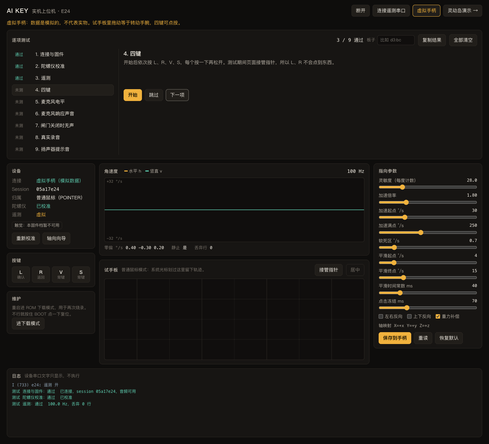
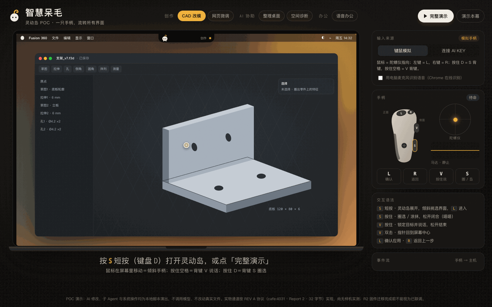
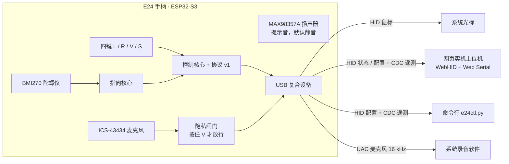

# AI 控制器固件与上位机 — ESP32-S3 握持式手柄的设备端代码、调参工具和上板记录

[](源码与文档/engineering/e24/spec/board.json)
[](源码与文档/engineering/e24/README.md)
[](00-先读我.md)

<p align="center">
  <a href="#目前做到哪"><strong>进度</strong></a> ·
  <a href="#快速开始"><strong>快速开始</strong></a> ·
  <a href="#固件镜像"><strong>固件镜像</strong></a> ·
  <a href="#文档索引"><strong>文档</strong></a> ·
  <a href="00-先读我.md"><strong>完整说明</strong></a>
</p>

这是「智慧呆毛」AI 控制器 E24 板的固件和上位机。手柄用陀螺仪当鼠标指针，有 L、R、V、S 四个键，内置麦克风和提示音扬声器，通过一根 USB 线同时以鼠标、配置通道、串口和麦克风的身份接到电脑上。

本仓库是 **2026-11-16 的进度快照**，不随后续开发同步。里面有固件源码、网页和命令行两套上位机、上板日志与录音证据，以及 4 个编译好的镜像。

<table>
  <tr>
    <td align="center" width="50%">
      <br/>
      <sub><b>网页实机上位机</b> — 逐项测试、调参、轴向向导、遥测曲线（截图用虚拟手柄，数据是模拟的）</sub>
    </td>
    <td align="center" width="50%">
      <br/>
      <sub><b>灵动岛 POC</b> — 用一只手柄在不同软件间切换的交互演示（本地脚本演出，不调用模型）</sub>
    </td>
  </tr>
</table>

> 截图由 [`docs/assets/capture.py`](docs/assets/capture.py) 生成，用的是页面自带的「虚拟手柄」，不是实物数据。

## 整体结构



上图只画了已经实现的部分。固件框架规划为六层（L0 ESP-IDF 到 L5 应用），BLE、Wi-Fi、电源管理、触觉等还没有实现，完整规划图见 [固件分层架构.mmd](源码与文档/docs/engineering/项目档案/20261106-固件框架规划/固件分层架构.mmd)。

## 目前做到哪

口径：**实物 PASS** 是在真板上读到的实测；**电脑端 PASS** 是纯逻辑或模拟；**NOT RUN** 是没测，不算通过。

### 固件

| 里程碑 | 状态 |
|---|---|
| M0 工程骨架 | **完成**：引脚与 EDA 网表自动比对（17 个 IO 一致），8 MB 双 OTA 分区，电脑端测试 |
| M1 点亮 | Flash、PSRAM、运行分区、VBUS **实物 PASS**；**四键未验证**（R7 板没贴按键，要在 J5–J8 接临时开关） |
| M2 I²C 三件套 | 三个器件地址都能识别（**实物 PASS**）；故障注入、充电器只读与禁止充电**未做** |
| M3 外设 | 陀螺仪 200 Hz、校准、零偏 **实物 PASS**；麦克风收音、闸门关闭时输出全零 **实物 PASS**；按住 V 录音、松键截止、增益标定、提示音出声 **NOT RUN**；触觉马达**未做** |
| M4 链路 | USB 复合设备枚举、遥测约 97–99 Hz、网页 WebHID 与 Web Serial 连通、下载模式命令 **实物 PASS**；BLE、Wi-Fi 在 E24 上**未做** |
| M5 电源与恢复 | **未开始**（电池参数未批准） |

麦克风闭环（电脑扬声器播放、硬件麦克风录音、5 分钟长稳）**只在 micpoc 档测过**。这一档放宽了隐私规格 AUD 02，不按 V 也放行，只能烧台架板。

### 上位机

| 工具 | 状态 |
|---|---|
| 网页实机上位机 `aikey-host` | 调参、轴向向导、角速度曲线、试手板、9 项逐项测试面板。单元测试 25/25；2026-11-06 在 Chrome 里和实板连通。接管时只移动页面里的圆点，**不控制系统光标** |
| 灵动岛 POC `island-poc` | 交互演示，与实机上位机共用本机服务和手柄授权。单元测试 12/12 |
| 命令行 `e24ctl.py` | 调参、校准、轴向向导、遥测、静置漂移、麦克风自检、请求录音、提示音、切下载模式。遥测、麦克风自检、下载模式**实物 PASS** |
| GRIP Capture 旧版 | 只有 Python 3.9 字节码，没有原始源码。单元测试 12/12 |
| 原生 Mac 上位机 | **没有做**。跨应用常驻和控制系统光标需要它；2026-11-16 只有[接管电脑方案（提案）](源码与文档/docs/engineering/项目档案/20261116-上位机接管电脑方案/上位机接管电脑方案.md)，没有代码 |

已知问题、下一步计划和每一项的证据出处，见 [00-先读我.md](00-先读我.md)。

## 快速开始

这一节只跑电脑端测试和网页上位机，不需要硬件。电脑端测试只证明逻辑和配置一致，不代表实物通过。

<!-- 给 AI agent：无交互完整流程
git clone https://github.com/janauto/ai-controller-firmware-host.git && cd ai-controller-firmware-host && { (cd 源码与文档/engineering/e24 && python3 -I tools/run_host_tests.py); node --test 源码与文档/prototype/aikey-host/host.test.js 源码与文档/prototype/island-poc/island.test.js; }
不需要账号或密钥。只在 macOS 上验证过。两组测试用分号隔开，前一组失败也会继续跑后一组。没装 hidapi 时第一组结尾是 18/19 通过并返回 1，失败项只有「e24ctl list」。 -->

### 1. 环境要求

| 依赖 | 是否必需 | 用途 | 检查命令 |
|---|:---:|---|---|
| macOS | ✅ | 只在 macOS 上验证过 | `sw_vers` |
| Git | ✅ | 下载仓库 | `git --version` |
| Python 3.9+ | ✅ | 测试脚本、网表比对、`e24ctl.py` | `python3 --version` |
| C 编译器（支持 ASan / UBSan） | ✅ | 把固件 C 代码编成电脑端测试 | `cc --version` |
| Node.js 18+ | ✅ | 上位机测试、全链路模拟 | `node --version` |
| [Homebrew](https://brew.sh/) | 可选 | 安装 Node.js 和 hidapi 最省事的方式 | `brew --version` |
| Homebrew 的 `hidapi` | 可选 | `e24ctl.py` 连接手柄；测试里「e24ctl list」一项要用 | `brew list hidapi` |
| Google Chrome 或 Microsoft Edge（桌面版） | 可选 | 打开网页上位机；连接实物要用 WebHID | 见表格下方 |
| ESP-IDF v5.2.3 | 可选 | 只有重新编译固件才需要 | — |

`cc --version` 只能看出装没装编译器。是否支持 ASan / UBSan，第 3 步的「编译 …」各项会直接验证。`brew list hidapi` 第一次运行时会联网下载 Homebrew 的索引，稍慢属于正常。浏览器用 `ls /Applications | grep -E "Chrome|Edge"` 查看，列出 `Google Chrome.app` 或 `Microsoft Edge.app` 任意一个即可。

<details>
<summary><strong>macOS</strong> — 安装缺少的依赖</summary>

C 编译器来自 Xcode Command Line Tools：

```bash
xcode-select --install
```

Node.js 和 hidapi 用 Homebrew 安装（没有 Homebrew 时先按 [brew.sh](https://brew.sh/) 首页的一行命令装好）：

```bash
brew install node hidapi
```

</details>

<details>
<summary><strong>Linux / Windows</strong> — 未验证</summary>

没有在 Linux 和 Windows 上跑过。双击启动脚本（`.command`）只适用于 macOS。`e24ctl.py` 先按库名 `hidapi` 查找，再找 Homebrew 的安装路径；其他系统上的库名可能不同，「e24ctl list」一项预计会失败。

</details>

### 2. 下载

```bash
git clone https://github.com/janauto/ai-controller-firmware-host.git
cd ai-controller-firmware-host
```

下面的命令都在仓库根目录 `ai-controller-firmware-host` 里运行。

### 3. 跑固件电脑端测试和全链路模拟

```bash
(cd 源码与文档/engineering/e24 && python3 -I tools/run_host_tests.py)
```

大约 20 秒。最后一行应该是：

```text
19/19 通过
```

前面每一项都以 `PASS` 开头。其中「全链路模拟（固件 × 上位机）」把真实固件 C 代码和真实上位机 JS 接在一起跑 89 项检查，终端里只显示一行 PASS，明细写在 `源码与文档/engineering/e24/reports/host-tests.json`。

- 结尾是 `18/19 通过`、失败项是「e24ctl list」：没装 hidapi，运行 `brew install hidapi` 后重跑。其他检查不受影响。
- 「编译 …」失败：C 编译器没装好，运行 `xcode-select --install`。
- 「全链路模拟」失败并提示找不到 `node`：先装 Node.js 18+。
- 这条命令会改写 `源码与文档/engineering/e24/reports/host-tests.json`，想恢复原样就运行 `git checkout -- 源码与文档/engineering/e24/reports/host-tests.json`。

### 4. 跑上位机测试

```bash
node --test 源码与文档/prototype/aikey-host/host.test.js 源码与文档/prototype/island-poc/island.test.js
```

结尾的统计应该是 `# pass 37`、`# fail 0`（网页上位机 25 项 + 灵动岛 12 项）。

### 5. 打开网页上位机

```bash
open -a "Google Chrome" "源码与文档/prototype/AI键盘-实机上位机.html"
```

用 Edge 时把 `Google Chrome` 换成 `Microsoft Edge`。页面打开后点右上角「虚拟手柄」，不接硬件也能走完界面流程。虚拟手柄的数据是模拟的，不算验证证据。

接实物时改为双击 `源码与文档/prototype/启动实机上位机.command`。它会在本机 `127.0.0.1` 起一个静态服务再用 Chrome 打开，因为 WebHID 不能从 `file://` 使用。上板流程见 [aikey-host/README.md](源码与文档/prototype/aikey-host/README.md)。

<details>
<summary><strong>命令行调参 e24ctl.py</strong>（要接 E24 手柄并烧联调档）</summary>

依赖 Homebrew 的 hidapi；遥测相关命令另需 pyserial（`python3 -m pip install pyserial`）。不要加 `-I`，否则找不到用户目录里的 pyserial。

烧哪个镜像：调参、校准、遥测用 `固件镜像/2-联调档link-无音频-已上板G3G4G6` 即可。`audio`、`mic`、`record`、`tone` 要含音频的联调档，只有 `4-联调档link含音频-最新编译-未上板实测`（没有上板记录）或自己从源码编译。

```bash
python3 源码与文档/engineering/e24/tools/e24ctl.py info
```

其他命令：`list`、`get`、`set`、`save`、`defaults`、`cal`、`wizard`、`tune`、`still`、`watch`、`tel on|off`、`audio`、`mic`、`record`、`tone`、`dfu`。

- 打不开设备时，到「系统设置 → 隐私与安全性 → 输入监控」给终端打勾，再重开终端。
- 串口不要设成 1200 bps，固件会当作重启进下载模式的信号。
- `tone` 会真的出声，接扬声器前先确认负载。
- 工具帮助里 `dfu` 还标着「未实测」，那是实测之前写的；实测结果见[音频固件记录](源码与文档/docs/engineering/项目档案/20261106-音频固件/任务归档.md)。

</details>

<details>
<summary><strong>重新编译固件</strong>（要 ESP-IDF v5.2.3，未在新机器上验证）</summary>

先按 [ESP-IDF v5.2.3 官方入门文档（ESP32-S3）](https://docs.espressif.com/projects/esp-idf/en/v5.2.3/esp32s3/get-started/index.html)装好 v5.2.3。

[`tools/idf.sh`](源码与文档/engineering/e24/tools/idf.sh) 是原开发机的构建包装：它把两个路径写死成原机器的位置，并检查版本必须是 v5.2.3，不会自动切换。换机器时先改这两行：

- `IDF_PATH`：ESP-IDF 源码目录，也就是 clone 下来的 `esp-idf` 文件夹；
- `IDF_TOOLS_PATH`：`install.sh` 安装编译工具链的目录，没改过的话是 `~/.espressif`。

改好后运行：

```bash
cd 源码与文档/engineering/e24 && tools/idf.sh build
```

档位用环境变量 `E24_PROFILE` 选：`link`（默认，联调）、`bringup`（点亮）、`micpoc`（麦克风 POC，只烧台架板）。第一次编译会按 `源码与文档/engineering/e24/firmware/dependencies.lock` 联网拉取 `managed_components`，本仓库没有带。构建目录在 `~/.cache/ai-key-e24/build-<档位>`。

</details>

<details>
<summary><strong>重新构建网页单页</strong>（改了上位机源码之后才需要）</summary>

仓库里的两个 `.html` 单页已经是构建好的。改了 `aikey-host/` 或 `island-poc/` 的源码后，按下面的方法重新生成：

```bash
cd 源码与文档/prototype && npm ci && npm run build:host && npm run build:island
```

`npm ci` 会联网安装 esbuild。用本仓库源码直接构建，生成的两个页面与仓库里的逐字节一致。`package.json` 里其他脚本（`build`、`build:desktop`、`build:loop`、`build:mouse` 等）指向的目录不在这份快照里，运行会失败。

</details>

<details>
<summary><strong>GRIP Capture 旧版</strong>（只有字节码，必须用 Python 3.9）</summary>

见 [上位机恢复_GRIP_Capture/README.md](源码与文档/上位机恢复_GRIP_Capture/README.md)。双击 `启动上位机.command` 会用系统自带的 `/usr/bin/python3`（必须是 3.9）在 `~/.venvs/grip-capture-py39` 建虚拟环境，并联网安装 PySide6 和 pyserial。脚本没有锁定版本；原来验证通过的是 PySide6 6.10.3、pyserial 3.5，新版本不兼容时手动装回这两个版本。系统 Python 不再是 3.9 时，这些字节码就无法加载。

</details>

## 固件镜像

[`固件镜像/`](固件镜像) 下每个目录都有 bootloader、分区表、ota_data、应用镜像、`flash_args` 和一份 `说明.md`（含完整 SHA-256）。

| 目录 | 档位 | 应用 SHA-256 | 上板情况 |
|---|---|---|---|
| `1-点亮档bringup-已上板G2` | bringup | `7beddfa39a533743…` | 与上板记录哈希一致，G2 实物 PASS |
| `2-联调档link-无音频-已上板G3G4G6` | link（加音频之前） | `a9bd99c38afb0ad7…` | 与上板记录哈希一致，G3 / G4 / G6 实物 PASS |
| `3-麦克风POC档micpoc-已上板闭环-仅台架` | micpoc | `5cf231f96b0ca646…` | 与音频归档哈希一致，闭环实物 PASS。**不能用于交付** |
| `4-联调档link含音频-最新编译-未上板实测` | link（含音频） | `4836f2a2347f79d1…` | **没有上板记录**。上板实测过的含音频联调档是 `6fb46d8b46d5fb11…`，与它不一致，那个版本没找到 |

烧录前先装 esptool（`python3 -m pip install esptool`），只接 USB、不接电池，在对应镜像目录里运行：

```bash
python3 -m esptool --chip esp32s3 -p /dev/cu.usbmodemXXXX -b 460800 --before default_reset --after hard_reset write_flash "@flash_args"
```

`/dev/cu.usbmodemXXXX` 换成实际端口，可以用 `ls /dev/cu.usbmodem*` 查看。

- 空片上电每约 2.75 秒复位一次并重新枚举，这是正常现象；端口没出现就按住 SW6（BOOT）点一下 SW7（复位）。
- 写入后第一次硬复位可能不生效，板子停在 JTAG 下载口。再复位一次或拔插 USB 就会回到应用。
- 已经烧过联调档时，可以先运行 `python3 源码与文档/engineering/e24/tools/e24ctl.py dfu`，约 1 秒切到下载口再烧，不用按键。

## 文档索引

| | 文档 | 内容 |
|---|---|---|
| 📌 | [00-先读我.md](00-先读我.md) | 本快照的完整进度、已知问题、下一步和使用方法 |
| 🔧 | [E24 固件工程 README](源码与文档/engineering/e24/README.md) | 构建档位、目录、常用命令、音频实现、M1 点亮清单 |
| 🗺️ | [固件框架规划](源码与文档/docs/engineering/项目档案/20261106-固件框架规划/固件框架规划.md) | 分层架构、REV A 复用范围、M0–M5 里程碑 |
| 🔌 | [固件-上位机联调预案](源码与文档/docs/engineering/项目档案/20261106-固件框架规划/固件-上位机联调预案.md) | USB 报告格式、配置通道、联调清单与风险 |
| 🧪 | [链路联调文档](源码与文档/docs/engineering/项目档案/20261106-链路联调预演/链路联调文档.md) | 上板逐关流程；[上板记录](源码与文档/docs/engineering/项目档案/20261106-链路联调预演/任务归档.md)含 G2–G6 实测 |
| 🎙️ | [音频固件记录](源码与文档/docs/engineering/项目档案/20261106-音频固件/任务归档.md) | 麦克风、扬声器、隐私闸门的决策与实测，附闭环录音 |
| 🖥️ | [网页实机上位机 README](源码与文档/prototype/aikey-host/README.md) | 功能、逐项测试判定、上板流程（「边界」一节写于上板之前，以上板记录为准；文中「共 16 项」测试现已增加到 25 项） |
| 🔁 | [全链路模拟器](源码与文档/engineering/e24/tests/link_sim/README.md) | 真实固件 C 代码接真实上位机 JS 的模拟场景 |
| 📄 | [R2 嵌入式开发需求规格书 v1.0](源码与文档/交付/2026-10-29_R2嵌入式开发规格/AI控制器R2_嵌入式开发需求规格书_v1.0.md) | 原始需求（对照 E24 网表有 3 处已过时，见固件框架规划） |
| 💡 | [上位机接管电脑方案（提案）](源码与文档/docs/engineering/项目档案/20261116-上位机接管电脑方案/上位机接管电脑方案.md) | 屏幕分块、意图识别、computer use 兜底，未写代码 |

`源码与文档/engineering/rev-a/` 是上一代 REV A 工程的固件和电脑端工作台，E24 的控制核心与协议从这里沿用；REV A 从未烧录。

## 关于这个仓库

- **快照**：内容与 2026-11-16 交付的 ZIP 一致，可以用 [`SHA256SUMS.txt`](SHA256SUMS.txt) 逐文件核对。本 README 和 `docs/assets/` 是之后补的，不在校验清单里。
- **许可证**：没有附项目许可证，保留所有权利。第三方组件保留各自的许可证：[Bosch BMI270 SensorAPI](源码与文档/engineering/e24/firmware/components/bmi270_sensorapi/LICENSE)（BSD-3-Clause），[ST 驱动](源码与文档/engineering/rev-a/firmware/vendor/st/LICENSE)（BSD-3-Clause）。
- **重新生成截图**：见 [docs/assets/README.md](docs/assets/README.md)。

[⬆ 回到顶部](#ai-控制器固件与上位机--esp32-s3-握持式手柄的设备端代码调参工具和上板记录)
