# AI 控制器 E24 固件框架规划（BSP → 应用层）

日期：2026-11-06　状态：**规划稿，未写代码、未构建、未上板**
目标硬件：ESP32-S3-WROOM-1-N8R8 主板（E24 系列；手上的 R7 首板与之接口一致，见第 1 节）
SDK：沿用锁定的 **ESP-IDF 5.2.3**（未经同意不切换）

## 0 依据与基线

| 来源 | 版本 / 校验 | 用途 |
|---|---|---|
| [R2 嵌入式开发需求规格书 v1.0](../../../../交付/2026-10-29_R2嵌入式开发规格/AI控制器R2_嵌入式开发需求规格书_v1.0.md) | 2026-10-29，SHA-256 `fa860696…dff92` | 功能、交互、协议、验收要求（第 3～11 节大部分沿用） |
| 嘉立创EDA 在线回读网表 | 2026-11-06 00:4x，工程 `584e7353…750d0`，Board「01-E24音频整改-暂缓打板」，原理图「02-E21原理图-零警告基线」P1+P2，[快照](证据/E24-网表回读-20261106.json) SHA-256 `270dbab0…f5209` | **引脚与外设的唯一依据**（73 个位号、40 个网络） |
| [R7 首板外设采购与接线](../../../../hardware/validation/ai-engineering/20261104-E24现货兼容替代料/R7-J2留空直焊/首板外设采购与接线.md) | 2026-11-04 | 电池、扬声器、马达候选型号 |
| `engineering/rev-a/firmware/` | REV A 旧实现 | 可复用的纯逻辑模块与迁移入口 |

R7 首板一致性：AMP_EN、USB_VBUS_PRESENT、TPS3808、ICS-43434 在 R4 回读文件里已出现，R7 由 R4 派生，所以首板和当前原理图的固件接口一致。**这个结论没有和板厂订单 Gerber 逐项比对**，上电前用万用表抽查 GPIO15/16 的走线即可关闭。

## 1 当前硬件与 R2 规格书的差异（必须先改的地方）

规格书是 10-29 的 R2 版，后来又改过几轮。下面这些点以**当前网表为准**，规格书对应条目作废：

| # | 当前硬件（网表事实） | R2 规格书写法 | 固件影响 |
|---|---|---|---|
| Δ1 | U3 麦克风是 **ICS-43434**（TDK），SELECT=GND → 左声道 | SPH0645LM4H-B-8，24bit/18bit 精度 | I²S RX 格式、符号扩展、移位按 ICS-43434 手册重推；SPH0645 的常数一律不沿用。32 kHz 是否在它支持的采样率范围内需查手册确认 |
| Δ2 | **GPIO15 = USB_VBUS_PRESENT**：VBUS_FUSED → R17 221k / R18 24.3k 分压 → TPS3808G01 SENSE；开漏 RESET 经 R19 100k 上拉到 3V3 | “没有 VBUS 检测线”，P0 ① 未关闭 | 硬件已补上，**P0 ① 在硬件侧关闭**。按 0.405 V 门限估算约 4.09 V 判定有电（待按手册核对）；高电平 = 插着 USB。CT 悬空，释放延时取手册固定值。USB 插拔逻辑以这根线为准 |
| Δ3 | **GPIO16 = AMP_EN** → R20 2.21k → MAX98357A SD_MODE | “SD_MODE 直连 VSYS，无软件关断” | 功放现在**可以软件关断**。上电第一步把 GPIO16 拉低。SD_MODE 同时决定声道，2.21k 上拉推算落在“左声道”区间，需对照手册阈值并实测 |
| Δ4 | USB D± 串 22 Ω（R15/R16）+ USBLC6 ESD（U9） | 直连 | 无软件改动 |
| Δ5 | J5～J12 并联在四个按键网络上（外接按键焊盘，1 脚信号 / 2 脚 GND） | 无 | 无 GPIO 变化，外接键与板载键并联，同一套去抖 |
| Δ6 | GPIO17/18 均未连接 | 旧 REV A 用 GPIO17 关断触觉 | 触觉只能走 I²C（GO=0 + 待机），与规格书 HAP 01 一致 |
| Δ7 | R7 首板 J2 不装座，电池引线直焊 | J2 三线座 | 无软件改动；NTC 仍接 BAT_NTC |

规格书中**仍然成立**、直接沿用的：I²C 三个器件与地址、按键与 BOOT/EN、IMU 引脚、充电与稳压拓扑、交互规则（第 6 节）、协议（第 7～8 节）、启动与降级（第 9 节）、验收矩阵（第 11 节）。

## 2 引脚表（E24，网表 2026-11-06）

| GPIO | 网络 | 方向 | 说明 |
|---|---|---|---|
| EN | MCU_EN | 复位 | SW7 复位键，10k + 1 µF |
| GPIO0 | BOOT_N | 启动 | SW6 下载键，10k 上拉 |
| GPIO4 | I2S_BCLK | 输出 | 麦克风与功放共用位时钟 |
| GPIO5 | I2S_WS | 输出 | 共用帧时钟 |
| GPIO6 | MIC_DOUT | 输入 | ICS-43434 数据，R3 100k 下拉 |
| GPIO7 | SPK_DIN | 输出 | MAX98357A 数据 |
| GPIO8 / GPIO9 | I2C_SDA / I2C_SCL | 开漏 | R1/R2 4.7k 上拉；BMI270 0x68、BQ25180 0x6A、DRV2605L 0x5A |
| GPIO10 | IMU_INT | 输入 | BMI270 INT1，无外部上拉，驱动需配成推挽 |
| GPIO11 | CHG_INT | 输入，低有效 | BQ25180 /INT，R4 10k 上拉 |
| GPIO12 / 13 / 14 / 21 | KEY_LEFT / RIGHT / VOICE / DRAW | 输入，低有效 | R10～R13 10k 上拉；J5～J12 并联外接键 |
| **GPIO15** | **USB_VBUS_PRESENT** | 输入，高 = 有 VBUS | TPS3808 开漏 + R19 100k 上拉 |
| **GPIO16** | **AMP_EN** | 输出，高 = 开功放 | 经 R20 2.21k 到 SD_MODE；上电默认拉低 |
| GPIO19 / 20 | USB D− / D+ | USB 专用 | 内置 USB PHY |

保留与禁用：GPIO35/36/37 被 Octal PSRAM 占用；GPIO0/3/45/46 是启动相关脚。空闲且引出到模组焊盘的有 GPIO1/2/17/18/38～42/47/48、RXD0/TXD0，但**板上都没有连出**，没有 UART 调试座。

## 3 固件分层框架图

```mermaid
flowchart TB
  subgraph APP["L5 应用层  app/"]
    direction LR
    A1["启动编排<br/>SYS01 四步启动"]
    A2["控制核心状态机<br/>owner POINTER/HOST · 租约 750ms<br/>录音/圈画互斥 · 安全释放"]
    A3["语音会话<br/>按住 V + HOST + RECORD 许可"]
    A4["状态上报<br/>0x80 状态 · 0x81 运动 · ACK"]
    A5["故障降级<br/>SYS02 故障表"]
  end

  subgraph PROTO["L4 协议与链路层  protocol/ + transport/"]
    direction LR
    P1["协议 v1 编解码<br/>32 字节 · CRC16 · session/seq"]
    P2["链路管理<br/>USB > BLE > Wi-Fi · 单一输入所有者"]
    P3["USB 复合设备 TinyUSB<br/>HID 鼠标 RID1 · 控制 RID2 · 配置 RID3<br/>UAC 麦克风 16k · 开发版 CDC 日志"]
    P4["BLE NimBLE<br/>HID over GATT · 自定义控制 GATT"]
    P5["Wi-Fi<br/>TLS 语音流 · 10ms/帧"]
  end

  subgraph SVC["L3 系统服务层  services/"]
    direction LR
    S1["音频服务<br/>共享时钟启停 · 32k→16k 抽取<br/>隐私闸门 · 播放混音/渐变"]
    S2["运动服务<br/>零偏/轴矩阵校准 · 相对位移 · 居中"]
    S3["电源服务<br/>充电配置档 · 看门狗 10s · VBUS 事件 · 睡眠协调"]
    S4["触觉服务<br/>效果队列 · ≤80ms · 互锁"]
    S5["输入服务<br/>边沿事件 · 语音键快速截止 ≤10ms"]
    S6["配置与存储<br/>NVS 版本化 · 校准 · 绑定"]
    S7["诊断<br/>器件状态 · 故障位 · 复位原因 · 日志"]
  end

  subgraph DRV["L2 器件驱动层  drivers/"]
    direction LR
    D1["BMI270<br/>Bosch SensorAPI"]
    D2["BQ25180<br/>读改写 + 回读"]
    D3["DRV2605L<br/>LRA · GO=0 + 待机"]
    D4["ICS-43434<br/>I²S RX 格式转换"]
    D5["MAX98357A<br/>AMP_EN · 零输出防爆音"]
    D6["按键<br/>去抖 25ms"]
    D7["VBUS 检测<br/>GPIO15"]
  end

  subgraph BSP["L1 板级支持包  bsp_e24/"]
    direction LR
    B1["引脚表<br/>由 board.json 生成"]
    B2["安全初始态<br/>AMP_EN 低 · I²S 静止"]
    B3["I²C 总线管理<br/>单一互斥 · 20ms 超时 · 重试 2 次"]
    B4["I²S 全双工<br/>单控制器 · 32kHz · 共享 BCLK/WS"]
    B5["GPIO 中断 → 事件队列"]
    B6["Flash 8MB / PSRAM 8MB<br/>分区表"]
  end

  subgraph IDF["L0 ESP-IDF 5.2.3 + FreeRTOS"]
    direction LR
    I1["driver: i2c_master · i2s_std · gpio"]
    I2["esp_tinyusb · NimBLE · esp_wifi · mbedTLS"]
    I3["nvs_flash · esp_pm · esp_timer"]
  end

  HW["硬件：ESP32-S3-N8R8 · BMI270 · ICS-43434 · MAX98357A · BQ25180 · DRV2605L · TPS3808 · 4 键"]

  APP --> PROTO --> SVC --> DRV --> BSP --> IDF --> HW
  APP --> SVC
```



一句话分工：**BSP 只管“这块板的线怎么接、上电是什么状态”；驱动只管“一颗芯片怎么用”；服务把芯片组合成能力（录音、指向、充电）；协议和链路负责“和电脑说话”；应用层只做规则和状态机。** 上层不跳过中间层直接碰寄存器。

## 4 每层的具体内容

### L1 BSP `components/bsp_e24/`

- **引脚表单一来源**：`spec/board.json`（从网表生成）→ 生成 `bsp_pins.h`。加一个检查脚本：把 EDA 导出的网表和 board.json 比对，不一致就构建失败。规格书 MIG 01 要求“不能只改头文件让生成器恢复旧脚位”，这里用比对脚本兜住。
- **安全初始态**（`bsp_early_init()`，app_main 第一行）：GPIO16 输出低（功放关）、GPIO4/5/7 输出低、四个按键和 GPIO15 设为输入、记录复位原因。
- **I²C 总线**：IDF 5.2 的 `i2c_master` 新驱动，一条总线三个设备句柄。先跑 100 kHz，测上升时间后再上 400 kHz。所有访问走一个互斥锁，单次事务超时 20 ms、最多重试 2 次。
- **I²S 全双工**：一个 I²S 控制器（I2S_NUM_0）同时建 TX 和 RX 通道，共用 BCLK/WS，32 kHz、每槽 32 bit（BCLK = 2.048 MHz）。时钟由音频服务统一启停，驱动层不允许各自重配 GPIO4/5。
- **GPIO 中断**：IMU_INT、CHG_INT、VBUS_PRESENT、四个按键 → ISR 只记时间戳和事件进队列，不在中断里读 I²C。
- **存储与内存**：sdkconfig 改为 8 MB Flash、Octal PSRAM；音频环形缓冲和 Wi-Fi/TLS 放 PSRAM，DMA 描述符放内部 RAM。

### L2 驱动 `components/drivers/`

| 驱动 | 要点 | 依据 |
|---|---|---|
| BMI270 | 锁定 Bosch SensorAPI 版本和配置文件哈希；复位 → 装配置 → 查 INTERNAL_STATUS，才算就绪；INT1 显式配推挽、电平、锁存；初始 ±4g / ±2000°/s / 200 Hz | 规格 DRV 01 |
| BQ25180 | 寄存器读改写、保留位不动、写后回读；看门狗策略显式设定；**电池参数未批准前禁止充电**（默认关充电） | 规格 PWR 01/02 |
| DRV2605L | EN 硬接 3V3，只能 I²C 控制；LRA 模式；停止 = 写 GO=0 再进待机；参数按 C10-100（175 Hz、2.0 Vrms 额定）计算，固定在壳里后再自动校准 | 规格 HAP 01、R7 外设记录 |
| ICS-43434 | 左槽、MSB 对齐、24 bit 有效位的符号扩展；用逻辑分析仪和已知音频确定移位，不抄旧常数 | Δ1 |
| MAX98357A | AMP_EN 控制开关；开启前先送零、关前先渐变到零；增益固定 3 dB（GAIN_SLOT 100k 接 VSYS） | Δ3、规格 AUD 03 |
| 按键 | 4 路低有效，25 ms 去抖；**语音键松开走快速通道**，不等去抖就关采集许可 | 规格 KEY 01/02 |
| VBUS | GPIO15 双边沿中断 + 软件去抖；提供“插入/拔出”事件 | Δ2 |

### L3 服务 `components/services/`

- **音频服务**：RX 链路 = I²S 32 kHz → 格式转换 → 抗混叠 FIR → 2:1 抽取 → 16 kHz/16 bit 单声道 → PSRAM 环形缓冲 → **隐私闸门**（只有“按住 V + 主机已取得归属 + 允许录音”三者同时满足才放行；松键、租约超时、断连、溢出时立刻关闸并清空缓冲）。TX 链路 = 提示音 → 重采样到 32 kHz → 音量渐变 → 左槽。录音期间禁止播放和振动。无录音无播放时停时钟、关功放。
- **运动服务**：传感器轴 → 握持坐标的矩阵放 NVS（PCB 安装方向没冻结）；静止零偏、死区、时间戳检查；居中只重建参考姿态。IMU 故障时停位移、保留点击。
- **电源服务**：充电状态机（无输入 / 充电中 / 充满 / 温度抑制 / 故障），处理 /INT，每 10 s 喂充电器看门狗；VBUS 插拔事件交给链路管理；进睡眠前关音频、停触觉、协调看门狗。**没有电量计**，上报 battery_valid=0。
- **触觉服务**：效果队列、单次 ≤80 ms、录音/圈画时拒绝；总线失联记“停止未确认”。
- **配置与存储**：NVS 分命名空间（校准、绑定、用户设置），带版本号和范围校验；配对信息不进日志。
- **诊断**：每个器件 absent / initializing / ready / fault 四态，汇总成 hardware_faults 位图上报。

### L4 协议与链路

- **协议 v1**：沿用 REV A 的 32 字节帧、CRC16（0xFFFF / 0x1021 / 不反射）、session + sequence、ACK 码。纯 C、不依赖 IDF，可以在电脑上跑单元测试。
- **链路管理**：USB 优先，同一时间只有一个输入所有者和一条语音路径；切换链路前先释放输入、结束语音。USB 插拔以 GPIO15 为准。
- **USB 复合设备**（TinyUSB）：HID 鼠标 RID 1、控制 RID 2、配置 RID 3、UAC 麦克风 16 kHz 单声道。**开发版额外加一个 CDC 口输出日志**（见第 6 节）。0xCAFE/0x4031 只是开发 VID/PID。
- **BLE**（NimBLE）：HID over GATT + 自定义控制 GATT。
- **Wi-Fi**：TLS 语音流，10 ms 一帧（160 个 int16）。

### L5 应用层 `main/` + `app/`

- **启动编排**：照规格 SYS 01 的四步——GPIO 安全态 → I²C 器件识别（充电器优先）→ IMU/音频/触觉初始化（全部默认关闭输出）→ 开 USB/BLE 并发布能力。任何一个器件缺失都不能卡住启动。
- **控制核心**：复用 REV A 的 `controller.c`、`link_policy.c`，按 E24 去掉 MIC_EN、RGB、CHG_EN、电量计相关分支。
- **故障降级**：按规格第 9 节的故障表执行。

## 5 任务与优先级（FreeRTOS 草案）

| 任务 | 核 | 优先级 | 职责 |
|---|---|---|---|
| tinyusb | 0 | 高 | USB 协议栈 |
| input_ctrl | 0 | 最高（应用内） | 按键事件、控制核心状态机、协议命令处理 |
| audio_rx | 1 | 高 | I²S 读、抽取、闸门、投递到链路 |
| audio_tx | 1 | 中 | 提示音播放 |
| periph | 0 | 中 | **唯一的 I²C 使用者**：IMU 读数、充电器、触觉 |
| link | 0 | 中 | BLE / Wi-Fi 状态与发送 |
| housekeeping | 任意 | 低 | 1 Hz：看门狗喂狗、状态上报、诊断 |

“I²C 只在 periph 一个任务里访问”可以替代大部分加锁，也满足规格书“充电/马达轮询不能阻塞输入”的要求。

## 6 两个工程问题（2026-11-06 用户确认：都按建议定）

> **已定**：① 日志点亮阶段走 USB-Serial-JTAG，之后开发版在 USB 复合设备里加 CDC 日志口，并提供“重启进下载模式”命令；② 8 MB 分区采用双 OTA（2 × 3 MB）方案，下表即 M0 采用的分区。

1. **调试日志从哪出？** 板上没有 UART 座，REV A 的 sdkconfig 却是 `CONFIG_ESP_CONSOLE_UART_DEFAULT=y`，照搬会看不到任何日志。ESP32-S3 的 USB-Serial-JTAG 和 TinyUSB 共用同一个 USB PHY，TinyUSB 一启动，JTAG 串口就没了。建议：
   - 点亮阶段（M1）先不启 TinyUSB，日志走 USB-Serial-JTAG；
   - 之后开发版在复合设备里加一个 CDC 口输出日志，量产版去掉；
   - 另加一条“重启进下载模式”的控制命令。否则 TinyUSB 跑起来以后 esptool 自动复位失效，只能手按 BOOT + EN。
2. **分区要不要预留 OTA？** 现在 REV A 是 factory 4 MB + storage 1 MB，没有 OTA。8 MB Flash 可以放两个 3 MB 的 OTA 槽：

   | 名称 | 类型 | 大小 |
   |---|---|---|
   | nvs | data/nvs | 24 KB |
   | otadata | data/ota | 8 KB |
   | phy_init | data/phy | 4 KB |
   | ota_0 | app | 3 MB |
   | ota_1 | app | 3 MB |
   | coredump | data/coredump | 64 KB |
   | storage | data/spiffs | 剩余约 1.9 MB |

   带 BLE + Wi-Fi + TLS + TinyUSB 的镜像预计 1.5～2 MB，3 MB 槽有余量（**预估，需看实际构建**）。

## 7 目录结构建议

保留 `engineering/rev-a/` 不动以便追溯，新建 E24 工程：

```text
engineering/e24/firmware/
├── CMakeLists.txt · sdkconfig.defaults（8MB/Octal PSRAM/控制台）· partitions.csv
├── spec/board.json                 ← 引脚唯一来源
├── tools/check_board_vs_netlist.py ← 网表比对
├── components/
│   ├── bsp_e24/                    ← L1
│   ├── drivers/{bmi270,bq25180,drv2605l,ics43434,max98357a,keys,vbus}/
│   ├── services/{audio,motion,power,haptic,input,settings,diag}/
│   ├── protocol/                   ← 从 rev-a/core/protocol.* 迁来，纯 C
│   ├── transport/{usb,ble,wifi,link_policy}/
│   └── core/                       ← controller、audio_filter（新系数）、motion 纯逻辑
├── main/app_main.c                 ← 启动编排
└── test/host/                      ← 协议、控制核心、滤波器的电脑端单元测试
```

REV A 中可直接复用（改动小）：`protocol.c/h`、`controller.c`、`link_policy.c`、`settings.c`、`motion.c`。需要重写：`imu.c`（LSM6 SPI → BMI270 I²C）、`audio_capture.c`（PDM → 标准 I²S 全双工）、`peripheral_bus.c`（去电量计、加 BQ25180）、`usb_transport.c`（VBUS 改读 GPIO15）、`audio_filter` 系数（48→16 改为 32→16）。

## 8 里程碑（在规格书 M1～M5 基础上细化）

| 阶段 | 内容 | 完成标志 |
|---|---|---|
| M0 工程骨架 | 新建 e24 工程、board.json + 比对脚本、8 MB 分区、电脑端单元测试跑通协议 | 构建通过；比对脚本 17 个 IO 与网表一致（2026-11-06 已完成，见 `engineering/e24/`） |
| M1 点亮 | 上电、复位原因、USB-Serial-JTAG 日志、按键边沿、GPIO15 插拔、AMP_EN 默认低 | R7 首板上实测 |
| M2 I²C 三件套 | 三个地址识别、故障注入（拔器件/超时不卡输入）、充电器只读 + 禁止充电 | 规格 T02 |
| M3 外设联调 | IMU 静态/单轴、I²S 波形（32 kHz WS / 2.048 MHz BCLK）、录音到 16 kHz、低音量播放、马达校准 | 规格 T03/T04/T06/T11 |
| M4 链路 | USB 复合设备 → BLE → Wi-Fi，与电脑端联调，协议反例 | 规格 T09/T10 |
| M5 电源与恢复 | 充电配置档（电池批准后）、睡眠唤醒、功耗、温升、故障恢复 | 规格 T07/T12 |

## 9 阻塞项与待你决定

| 项目 | 状态 | 卡住哪里 |
|---|---|---|
| 电池型号与 NTC | 602040 500 mAh 询样中，参数未批准 | BQ25180 配置档、规格 T07；之前固件**默认禁止充电** |
| 扬声器 | 候选 8 Ω / 1 W（JC-SPK1511），未实测 | 实际播放、音量上限、T06 |
| 马达 | 候选 C10-100 LRA，未装壳校准 | DRV2605L 参数与校准、T11 |
| 麦克风物理断电 | 硬件没有（VDD 直连 3V3） | 只能做软件隐私；若产品必须物理断电需改板 |
| ICS-43434 采样率与格式 | 未查手册确认 32 kHz | 音频时钟方案 |
| SD_MODE 声道 / VBUS 门限 | 按电阻推算，未实测 | 播放声道、插拔判定 |
| 调试口方案 | **已定**（2026-11-06）：JTAG 串口 → 开发版 CDC | — |
| 是否预留 OTA | **已定**（2026-11-06）：双 OTA 2 × 3 MB | — |
| BLE / Wi-Fi 是否首版就做 | 规格沿用，但没有说优先级 | M4 范围 |

以上均为规划，未修改固件、未构建、未烧录，也不代表任何验收已通过。
