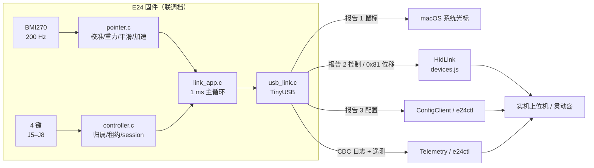

# E24 固件 × 上位机 链路联调文档

日期：2026-11-06　状态：**上板前预演完成，补丁已合入 `main`；未接实物。** 第 1、3 节记录的是合入前的问题，P2 除 L07 外未改。

## 1 结论

把真实固件 C 代码和真实上位机 JS 接成一条链路跑了 24 个场景：**81 项检查里 61 项通过，20 项失败，集中在 11 个问题上。**

- **主干是通的。** USB 描述符、握手、位移守恒、调参、轴向向导、租约、下载模式全部通过。
- **断开、交还、切换这类边界有问题。** 这些问题在单元测试里看不到，要两端连起来才出现。
- **有 4 个问题明天大概率会碰到，而且看起来像硬件或手感问题，很容易查错方向。** 见第 3 节 P0。
- **还有 1 个流程问题：按照今天的焊接方案，板上没有按键。** 点亮档和联调档的按键步骤都做不了。

补丁已合入：81/81 通过，原有测试全部通过，ESP-IDF v5.2.3 编译通过。改动 60 行，[补丁留档](证据/候选修法.patch)。

**接下来：焊接时接上临时按键 → 按第 5 节逐关上板。**

## 2 今天的任务怎么串成一条链路

| 今天的任务 | 产出 | 在链路里的位置 | 验证到哪一步 |
|---|---|---|---|
| [固件框架规划](../20261106-固件框架规划/任务归档.md) | `engineering/e24/`：点亮档、联调档 | 设备端全部 | 编译、电脑端测试 |
| e24ctl（同上） | `engineering/e24/tools/e24ctl.py` | 命令行调参，网页的后备 | 对固件 C 代码测试 |
| [实机上位机](../20261106-实机上位机/任务归档.md) | `prototype/aikey-host/` | 调参、向导、遥测、试手板 | 对固件 C 代码测试，虚拟手柄 |
| [灵动岛 POC](../20261106-灵动岛POC/任务归档.md) | `prototype/island-poc/` | HidLink 传输层、产品交互 | 假设备 |
| [手工焊接方案](../../../../hardware/validation/ai-engineering/20261106-E24手工焊接方案/手工焊接方案.md) | 焊接顺序、分段验证 | 决定每一关有哪些硬件可用 | 未实物试焊 |



## 3 问题清单

编号对应模拟场景，复现命令见第 4 节。“现象”的数字都是模拟实测。

### P0：合入前不要上板

| 编号 | 现象 | 根因 | 修法 |
|---|---|---|---|
| **L02** 失焦后反复重连 | 页面失焦 10 s：发 HELLO 15 次，session 换 5 次；2.6 s 时误报“设备未应答 HELLO”；**系统鼠标按住的左键被切断**。灵动岛页面这时会掉回键鼠模拟（`main.js:346`），链路对象还留着 | 收到新 session 时不看 `suspended` 就发 HELLO（[devices.js:55](../../../../prototype/island-poc/devices.js)，重试定时器 `:92` 同样）。HELLO 不跟保活，750 ms 后租约到期又换 session，循环 | 两处加 `!suspended` 判断 |
| **L01** 交还后 750 ms 切断鼠标 | RELEASE 后按住左键拖动，到第 750 ms 左键被强制松开，session 也变了 | RELEASE 不清 `host_connected`（[controller.c:89](../../../../engineering/e24/firmware/components/aikey_core/controller.c)），租约照常到期，走完整的断连流程（`:43–47`），把正在按的键隔离掉 | 租约到期时，只有确实持有输入（HOST、录音、圈画、触觉）才走断连流程；已交还的空闲连接静默结束 |
| **L09** 慢速移动被吃掉 | 2 °/s 匀速转 6 s：应走 336 计数，只走 113；零偏被带到 −1.62 °/s；停下后光标**自己往回爬 92 计数**。手持 1 °/s：应 168，实得 39 | 判定静止的门限是相对零偏 2.5 °/s，慢速转动被当成静止，零偏跟踪把真实运动吸收了（[pointer.c:126、:167](../../../../engineering/e24/firmware/components/aikey_core/pointer.c)） | 跟踪门限收到 0.6 °/s，时间常数从 2.5 s 加到 10 s。仍能跟温漂（A10 通过）。阈值要用实测手持数据再定 |
| **L03** 重连后位移翻倍 | 断开再连接，旧的 HidLink 还在收报告，每帧处理两次 | `inputreport` 监听器是匿名函数，`close()` 没摘（[devices.js:25](../../../../prototype/island-poc/devices.js)）。浏览器对同一设备返回同一个对象 | 保存函数引用，`close()`、`lost()` 时摘掉 |
| **D1** 板上没有按键 | R7 没贴 SW1–SW4，四键只能接 J5–J8；焊接方案写“J5–J8 装壳时再接”。但点亮档第 5 步、联调档左右键点击都要按键 | 两份文档各自成立，放到一起冲突 | 已写进焊接方案和手册：**第 ③ 步接 4 个临时按键**（M1 就要用），不想焊就先用镊子短接 |

L01、L02、L09、L03 的共同点：现场看起来都像别的问题。分别会被当成“USB 不稳”“手柄断连”“手感差要调参”“灵敏度偏高”，然后拿错误的参数继续调。

### P1：上板前修，一行到几行的事

| 编号 | 现象 | 根因 | 修法 |
|---|---|---|---|
| **L05** IMU 初始化时被并发读 | `bmi270_init` 期间 `imu_read` 被调用 45 次（0.9 s 模型） | 任务先创建再初始化，等待超时后就去读（[link_app.c:150–151](../../../../engineering/e24/firmware/main/link_app.c)）。实物上可能让初始化偶发失败，这条模拟不出后果 | 任务先等启动信号，`imu_init` 成功后才放行 |
| **L11** IMU 虚焊时空转 | 初始化失败后每秒 50 次读总线，真机上每次打一条 I2C 错误，CDC 日志被淹没 | 同上，失败后任务不退出 | 同一处修复 |
| **L06** 电脑唤醒后光标跳 | 睡眠期间转动，唤醒后光标跳 1713 计数 | 累加器只在挂载下降沿清零一次（[link_app.c:169–177](../../../../engineering/e24/firmware/main/link_app.c)），之后继续累积 | 未挂载期间持续清零 |
| **L08** 配置偶发“session 不符” | session 刚变时写参数，重试一次仍失败 | 重试用的 session 来自状态报告，最多晚 100 ms（[devcfg.js:99](../../../../prototype/aikey-host/devcfg.js)）。回复里其实带着新 session | 重试时用回复里的 session |
| **L10** 故障位和行为不一致 | 日志说“停用指向”，IMU 恢复后位移照出，故障位却一直在 | 只置标志，没有真的停（[link_app.c:84](../../../../engineering/e24/firmware/main/link_app.c)） | 真的停用，重启恢复 |
| **L12** 按住 L 点接管 | HELLO 切断正在按的左键；随后被误报成“设备未应答” | HELLO 里释放输入（[controller.c:81](../../../../engineering/e24/firmware/components/aikey_core/controller.c)）；HELD 之后定时器继续重试 | 隔离改到 CLAIM 成功时；HELD 后等松键自动重试 |

### P2：不挡联调，顺手修或记下

| 编号 | 问题 | 处理 |
|---|---|---|
| **L07** | CDC 被卡住 100 ms 时写入半行，下一行拼在后面，两行都废（半行 8 次） | 放不下整行就丢整行，已含在补丁里 |
| **P2-1** | `#kvSession` 只在首帧更新，session 变了界面不变（[main.js:154](../../../../prototype/aikey-host/main.js)） | 每次都刷新 |
| **P2-2** | 灵动岛 error 时只把 `hid` 置空，不关设备（`island-poc/main.js:346`）。L02 修好后不易触发 | 先 `close()` 再回模拟 |
| **P2-3** | I²C 100 kHz 读 24 字节要 2.4 ms，200 Hz 下总线占用 49%，M3 接入触觉后会挤 | M2 时改 400 kHz，或只读陀螺、加速度和时间戳 15 字节 |
| **P2-4** | README 常用命令 `flash monitor` 对联调档无效：烧完 JTAG 口消失。多个 usbmodem 时 `/dev/cu.usbmodem*` 也会展开成多个 | 改文档，写明指定端口 |
| **P2-5** | 联调档用 `CONSOLE_NONE`：崩溃时哪个口都没有输出，只留 Flash coredump | 现场记住：循环重启时进下载模式读 coredump |

**预想有问题、模拟否定的：** 晚几秒打开串口，关键启动日志不会丢。CDC FIFO 在 DTR 拉高前保留最后 512 字节，只有第一行“板型”被挤掉，复位原因和 I²C 探测都还在（A11）。

## 4 模拟怎么做的，能证明什么

```bash
cd engineering/e24/tests/link_sim && node run.mjs
```

- 真实代码，一行未改：`link_app.c`、`usb_link.c`、`ptr_store.c`、`controller.c`、`protocol.c`、`devcfg.c`、`pointer.c`；`devices.js`、`protocol.js`、`devcfg.js`、`telemetry.js`、`wizard.js`。
- 替身：FreeRTOS、TinyUSB 端点与 CDC FIFO、BMI270 读数、NVS、WebHID、Web Serial、页面定时器。行为依据 TinyUSB 0.21、esp_tinyusb 1.7.6 的源码，共用 1 ms 虚拟时钟。
- 11 秒跑完。每条检查写的是“应该成立的行为”，所以修好后这份脚本就是回归门槛。

| 结果 | 当前代码 | 打补丁后 |
|---|---|---|
| 全链路模拟 | 61/81 | **81/81** |
| 固件电脑端测试 | 15/15 | 15/15 |
| 上位机测试 | 16/16 | 16/16 |
| 灵动岛测试 | 12/12 | 12/12 |
| ESP-IDF v5.2.3 联调档编译 | 已有记录 | 通过，0 警告，0x54080 字节 |

**模拟证明不了：** 主循环和 IMU 任务的真实并发、CPU 耗时、USB 电气、浏览器和 macOS 权限、真实手抖。手抖只用白噪声近似，所以 L09 的新门限是起点，不是定值。`main.js` 的界面代码没有跑，只照它的接法调用 HidLink。

证据：[当前代码](证据/模拟结果-当前代码.json)、[打补丁后](证据/模拟结果-候选修法.json)。

## 5 上板联调流程

每关过了才进下一关。命令在 `engineering/e24/` 下执行。只接 USB，不接电池。

### G0 代码门（今天能做）
- 已完成：补丁在 `main`，回归全过，主工作目录两档已编译。
- 把 `engineering/e24` 和 `.git` 设为“保留下载”，腾出磁盘（见第 6 节 E1）。

### G1 供电（焊接手册第 ② 步）
- 通过：C9 约 5 V，C18 3.3 V，电流正常。3V3 不对不往下焊。

### G2 点亮档（第 ③ 步后）
```bash
E24_PROFILE=bringup tools/idf.sh -p /dev/cu.usbmodemXXXX flash monitor
```
- 通过：`Flash 8192 KB，PSRAM 8192 KB -> PASS`、`运行分区 ota_0`、**`VBUS 存在`**、四键各出现按下和松开事件。
- **`VBUS 存在` 必须通过才能烧联调档。** 联调档用 GPIO15 判断 VBUS，U10、R18、R19 有问题时设备不上拉 D+，不枚举，也没有任何日志。

### G3 联调档与枚举（第 ④ 步后）
```bash
tools/idf.sh -p /dev/cu.usbmodemXXXX flash
```
```bash
python3 tools/e24ctl.py list
```
- 通过：出现 HID 接口（0xFF00）和 CDC 口，bcdDevice 0x0124。
- 失败先查：VBUS（G2）；`CONFIG_TINYUSB_MODE_DMA=y` 没实测过，枚举异常时改 Slave 模式试一次。

### G4 日志与 IMU
```bash
screen /dev/cu.usbmodemXXXX 115200
```
- 通过：I²C 三个地址 ACK、`BMI270 就绪`，放稳约 2.5 s 内 `陀螺仪已校准`（模拟 2.4 s）。退出 screen 再往下。
- 失败先查：无应答查 U2 虚焊；初始化报错查 L05 是否已合入。

### G5 当普通鼠标
- 转 30° 约走 840 计数（系统加速会放大，跟踪速度调到中档），放桌上不漂，点击正常。
- 轴向不对时先别调，到 G6 跑向导。

### G6 调参与向导
```bash
python3 tools/e24ctl.py info
```
- 打开实机上位机，连手柄和串口：网页打不开设备就用 e24ctl，并到“隐私与安全性 → 输入监控”检查授权。
- 通过：遥测约 100 Hz、丢弃计数接近 0；向导右转 ≈ +30°、上抬 ≈ −30°；`still -s 10` 漂移不超过 2 计数。
- **采一段手持数据**，定 L09 门限：
```bash
python3 tools/e24ctl.py watch -s 30 --csv /tmp/e24-hand.csv
```
- 满意后保存，断电重启确认参数还在。

### G7 HOST 与灵动岛
- 点“接管指针”：几 ms 内进 HOST，系统光标停，圆点跟手，四键亮灯。
- 交还后马上按住左键拖动 2 s，不能断（L01）。
- 进灵动岛：S 短按、S 长按圈画、V 双击居中。录音和振动显示暂不可用。

### G8 异常路径
| 操作 | 通过标准 |
|---|---|
| 切走页面 10 s，期间用手柄当鼠标 | 不重连，不断键；回来自动接管（L02） |
| 刷新页面 | 约 750 ms 内光标恢复 |
| HOST 时拔线再插 | 页面显示断开，按键不悬挂，重连正常 |
| 断开再连接，转 30° | 位移不翻倍（L03） |
| 合盖睡眠再唤醒 | 光标不跳（L06） |
| `e24ctl.py dfu` 或页面进下载模式 | 出现 JTAG 口；不行就按住 SW6 点 SW7 |

每关的结果写进本目录 `任务归档.md`，没测的不写通过。

## 6 只有上板才知道的风险

| 编号 | 风险 | 哪一关看 |
|---|---|---|
| H1 | TinyUSB DMA 模式 + 1 ms HID + CDC 复合设备，没有实测记录 | G3 |
| H2 | macOS 的 WebHID 和 hidapi 打开含鼠标集合的设备时，输入监控权限是否会拦 | G6 |
| H3 | Chrome 对同一设备返回同一对象，是 L03 的前提。按 Chromium 的行为建模，上板确认 | G8 |
| H4 | BMI270 数据就绪非锁存脉冲能否被上升沿稳定抓到。抓不到时退化成 50 Hz 轮询，跟手变差。看遥测采样率 | G6 |
| H5 | 日志和遥测在双核上交错写，模拟不了。看丢弃计数 | G6 |
| H6 | 联调档探测 0x6A，而点亮档为避开 BQ25180 看门狗不碰 I²C。观察 1 分钟内 VSYS 和 USB 是否掉电 | G4 |
| H7 | NVS 保存时 Flash 停顿，看是否掉帧、断租约 | G6 |
| H8 | 1200 bps 进下载模式、0x15 都未实测 | G8 |
| **E1** | **本次任务中 iCloud 把整个项目连同 `.git` 转成占位文件，git 和 node 读文件超时几分钟。磁盘已用 96%。** 明天烧录时再发生会卡住构建 | G0 |
| E2 | `managed_components` 只在主工作目录，worktree 里构建要联网。仓库也没有远端，代码只在这台机器和 iCloud | G0 |

## 7 补丁改了什么（已合入）

| 模块 | 改动 | 解决 |
|---|---|---|
| `controller.c` | 租约到期只在持有输入时走断连；HELLO 不释放输入，隔离改到 CLAIM | L01、L02、L12 |
| `pointer.c/.h` | 零偏跟踪新增门限和时长，放慢时间常数 | L09 |
| `link_app.c` | IMU 任务等初始化；故障真停用；未挂载不累积 | L05、L06、L10、L11 |
| `usb_link.c` | 遥测整行写入 | L07 |
| `devices.js` | 失焦不重连；摘监听器；HELD 后等松键 | L02、L03、L12 |
| `devcfg.js` | 重试用回复里的 session | L08 |

**用户确认合入后生效的行为变化：**
1. `controller.c` 不再和 REV A 一致。“租约超时换 session”收窄为只在持有输入时生效。联调预案已更新，规格书（2026-10-29 交付件）未改。
2. IMU 运行中故障后，要重启才恢复。
3. 零偏跟踪变慢：放桌上约 10 s 才跟上温漂。
