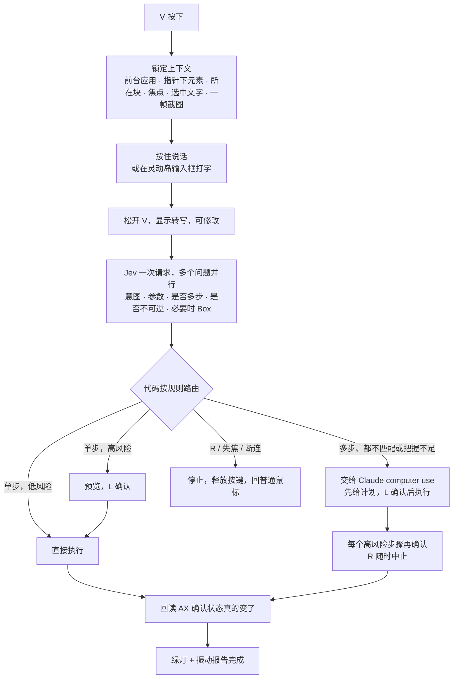

# 上位机接管电脑方案：屏幕四块切片 + Jev 意图判断 + Computer Use

- 日期：2026-11-16（Asia/Shanghai）
- 状态：**提案，未拍板，未实现**。不改变现行 [V0.3 交互定义](../../../../prototype/mouse-voice/README.md)。第 8 节列出它和已拍板内容的差异。
- 来源：用户口述想法——用 Jev 加 computer use 帮人快速接管电脑；把屏幕分成底部 Dock 栏和上方的软件、浏览器页面、子页面等部分，切成四块；按不同软件识别不同意图；用语音、文字和 computer use 操作电脑。

## 一句话

按住 V，指着屏幕说一句（也可以打字）。上位机先看你指在哪一块、前台是什么软件，再让 Jev 判断你要做什么。一步能完成的事由本机代码直接做，多步的复杂任务交给 Claude computer use。有风险的动作先预览，按 L 确认，按 R 取消。

## 0. 先说清两个名词

**Jev 不是编程语言。** 它是 TypeSafe 公司的模型，属于 TypeSafe 说的「System One」：输入一段状态（文字、截图、结构化数据），返回带概率的判断结果。按 TypeSafe 文档，它有四种问法：

| 问法 | 回答 | 本方案用来做什么 |
|---|---|---|
| Choice | 从给定选项里挑一个，附带各项的概率 | 选意图、选切片、选菜单项或标签 |
| Noul | 一个「是」的概率 | 是否需要多步、是否不可逆、目标是否在图里 |
| Score | 在定义好的刻度上打分 | 暂不用 |
| Box | 截图中某个东西的方框（四条边，按图宽高的比例给出） | AX 读不到目标时，在截图上定位 |

TypeSafe 文档明确说，这类模型**不写回复、不写代码、也不解释推理过程**。所以 Jev 适合当路由器：快速判断该走哪条路、填哪个参数。它不会规划，也不会自己一步步操作电脑。

**Computer use** 是 Claude 的电脑操作能力。Claude 看截图，决定点哪里、输入什么，执行后再截图，如此循环。当前模型（Claude Opus 5.5 / Sonnet 5.5）在 Claude API 上用 `computer_toolset_20260801` 工具集。每一步都要等一次模型往返，适合开放的多步任务；「切到微信」这种一句话就能做完的事，交给它反而慢。

因此分工是：**Jev 判断，代码执行，Claude 兜底。**

## 1. 屏幕四块切片

切法按「应用 → 窗口 → 页面 → 局部」由粗到细：

| 块 | 范围 | 主要读法 | 典型意图 | 默认风险 |
|---|---|---|---|---|
| ① Dock 栏 | 底部 Dock，含最近使用的应用 | 辅助功能接口（AX）读 Dock 的图标列表；系统接口读运行中的应用 | 打开、切换、隐藏、退出应用；打开最近文件 | 退出应用：中（可能有未保存内容） |
| ② 应用框架 | 菜单栏，以及窗口的标题栏、标签栏、工具栏、地址栏 | AX：菜单栏、工具栏、标签组；浏览器标签另用扩展或 AppleScript | 切换或关闭标签、新建、搜索、打开网址、执行菜单命令 | 关标签：低；菜单里的删除：高 |
| ③ 页面主体 | 当前网页、文档、代码或画布 | 先用 AX（网页由浏览器的 AX 树或扩展读 DOM），读不到再截图 + Box | 总结、滚动、点链接或按钮、填表、改写选中文字 | 提交表单：高 |
| ④ 子页面与浮层 | 侧边栏、弹窗、对话框、下拉菜单、子页面 | AX：对话框、Sheet、Popover；当前焦点元素 | 确认、取消、选择某项、切换子页面、关闭弹窗 | 对话框里的「确定」：高 |

### 怎么知道你说的是哪一块

1. **指针位置（最强的信号）**：V 按下的瞬间，取指针下的 AX 元素（`AXUIElementCopyElementAtPosition`），沿父级往上找到它属于哪一块。这正是 V0.3「按下即锁定目标」的延伸。
2. **圈选**：S 长按圈出的区域直接作为目标，不再推断。
3. **没有指向**（打字输入，或指针停在空白处）：让 Jev 在「四块 + 不涉及屏幕的全局命令」里选一个。

同一句话，指在不同的块，意思不同。比如「关掉这个」：

| 指着哪里 | 理解成 |
|---|---|
| Dock 里的微信图标 | 退出微信（中风险，先确认） |
| 浏览器的某个标签 | 关闭这个标签 |
| 一个弹窗 | 点弹窗的「取消」或关闭按钮 |
| 页面上的浮动广告 | 点广告的关闭按钮（通常要截图 + Box 定位） |

### 为什么切片对 Jev 有用

- **候选少了**：一个应用加一个块，通常只有十来个意图，不用在几百个意图里挑。判断更快，也更准。
- **看得清**：Jev 的图片输入每边限 280–1568 像素。以 14 寸 MacBook Pro 原生 3024 × 1964 为例，整屏要缩到约一半，Dock 图标和小按钮会糊。切出相关的一块再发，同样尺寸下细节更多；块仍然太大时再二次分块。TypeSafe 文档也建议先用 Choice 选出图块，再在图块里用 Box 定位。

## 2. 按软件识别意图：意图包

每个软件配一份**意图包**：在某个块里有哪些意图、每个意图要哪些参数、由什么执行、风险多大。示意（Chrome）：

```yaml
app: com.google.Chrome
slices:
  应用框架:
    - intent: 关闭标签
      args: { 标签: 从当前标签列表中选 }
      run: 浏览器扩展 tabs.remove
      risk: 低
    - intent: 打开网址
      args: { 网址: 从书签和历史中选，没有就交给 Claude }
      run: AppleScript 设置 URL
      risk: 低
  页面主体:
    - intent: 总结这页
      run: 读 DOM 正文 → Claude 总结（只读）
      risk: 低
    - intent: 点击
      args: { 目标: 从页面可点击元素中选 }
      run: 扩展 DOM click；读不到时用 Box 坐标模拟点击
      risk: 按目标文字判断，「提交、付款、删除」为高
```

参数尽量**从候选里选，而不是让模型生成**：标签名、菜单项、按钮文字都能从 AX 或 DOM 枚举出来，让 Jev 用 Choice 选。选出来的一定是屏幕上真实存在的东西。

### 没有意图包的软件也能用：通用菜单命令

每个 Mac 软件都通过 AX 暴露完整的菜单栏。把所有菜单项（标题、所在菜单、快捷键）列成候选，让 Jev 选一个，再对它执行 AXPress。这样不用逐个写意图包，任何软件的上千条菜单命令都能用一句话触发。工具栏按钮和对话框按钮同理。

建议首批写意图包的软件（待拍板）：系统通用（Dock、窗口、访达）、Chrome、代码编辑器加 Claude Code、钉钉或飞书。其余软件先用通用菜单命令，再用 Claude 兜底。

## 3. 一次请求的完整流程



各步说明：

1. **V 按下即锁定**：前台应用、指针坐标、指针下元素及其父级、所在块、焦点元素、选中文字，同时在内存里截一帧屏幕（ScreenCaptureKit）。之后指针移动不改变「这里」。
2. **说话**：声音来自手柄的 USB 麦克风（E24 已做按住 V 才放行的隐私闸门），在电脑上转文字。用 macOS 自带语音识别还是其他引擎，中文离线效果如何，都需要实测。
3. **Jev 判断**：同一份状态上的问题放进一次请求，并行回答。TypeSafe 的「Parallel questions」示例称，合并成一次请求比逐个发送快约 11.8 倍，便宜约 12.2 倍。一次请求包含：
   - Choice：意图（候选来自意图包、菜单和按钮枚举，外加「都不是」）；
   - Choice：各参数（从枚举出来的候选里选）；
   - Noul：这件事是否需要多步；
   - Noul：是否涉及发送、删除、提交、付款等不可逆操作；
   - 只有 AX 读不到目标时才加 Box，并配一个 Noul 判断目标在不在图里（Box 永远返回一个框，没有「找不到」）。
4. **路由规则写在代码里**，不交给模型：置信度阈值用真实说法调，不照抄示例；不可逆动作不管置信度多高都要 L 确认。
5. **执行优先级**：AX 动作（按下、置前、设值）> 软件快捷键或 AppleScript > 浏览器扩展操作 DOM > 按 Box 坐标模拟点击 > Claude computer use。越靠前越快、越可靠。
6. **回执**：执行后回读 AX，确认状态真的变了（例如标签少了一个、窗口到了前台），才亮绿灯并振动。沿用已定的「没收到确认就不提示完成」。

## 4. 四个键怎么用

不新增按键，沿用 V0.3 和灵动岛 POC 的语义：

| 键 | 在本方案里 |
|---|---|
| V 按住 | 锁定指向的目标，说话；松开后先核对文字（不变） |
| S 长按 | 圈出区域作为目标，松开后按 V 说要求（不变） |
| L | 确认执行（不变） |
| R | 取消。Claude 正在执行时按 R 立即停止，把控制交还给你 |
| S 短按 | 打开圆盘还是展开灵动岛，仍待拍板；本方案不依赖它 |
| 文字 | 开会等不方便说话时，在灵动岛输入框里打字，后续流程与语音相同 |

## 5. 安全与隐私

「接管电脑」比改沙盒代码风险更高，所以边界要更紧，不能更松：

- **两道确认保留**。发送、删除、提交、付款、关机、退出有未保存内容的软件，一律要 L 确认，不看置信度。
- **不代输密码，不代付款**。密码管理器、网银、系统设置、钥匙串等软件列入黑名单：不截图，也不执行。
- **截图上云是新的暴露面**。Jev 和 Claude 都是云端服务。默认先用 AX 文字，不截图；必须截图时只发相关的那一块，黑名单软件的窗口打码或干脆不发。和「音频不落盘、不上云」一样，「截图不上云」在实现之前不作为卖点。
- **R 随时中止**；页面失焦、手柄断连时立即停止执行，释放所有按键，重连后不重放。
- **日志**只记意图、动作和结果，默认不保存截图。
- **API 密钥**放 macOS 钥匙串，不写进代码或文档。若要对外分发，经自己的服务器转发，密钥不进客户端。

## 6. 实现形态

- **必须做原生 Mac 程序**：常驻菜单栏，加一个灵动岛浮层。网页做不到跨应用控制，也移动不了系统光标，[实机上位机说明](../../../../prototype/aikey-host/README.md)里已有记录。
- **需要的系统权限**：辅助功能（读界面、执行动作）、屏幕录制（截图）、麦克风、自动化（AppleScript 控制其他软件）。
- **手柄连接**：沿用 v1 协议（报告 2 和 3，HELLO / CLAIM / KEEPALIVE），只是从 WebHID 换成 macOS 原生 HID 接口。
- **Jev**：TypeSafe 提供 HTTP API 以及 Python、JavaScript SDK，没有 Swift SDK。Swift 程序直接调 HTTP 即可。
- **Claude**：默认 Claude Opus 5.5 加 `computer_toolset_20260801`。速度和成本若不合适，再评估别的型号。
- **建议**：POC 阶段先用 Python 写（pyobjc 调 AX，加 TypeSafe 和 Anthropic 的 Python SDK），尽快测出命中率和延迟；方向确认后再写成 Swift 原生程序。

## 7. 已知限制

以下各条来自 2026-11-16 查阅的 TypeSafe 文档和 Claude API 文档：

| 限制 | 影响 | 应对 |
|---|---|---|
| Jev 的图片输入标为「Dreamer-ready」，不是正式可用；要加专门的请求头；格式和精度可能变化 | 截图判断不能当主通道 | AX 优先，截图只做兜底 |
| 图片每边 280–1568 像素，单张不超过 16 MiB，只收 PNG 和 JPEG | Retina 整屏必须缩小 | 切片，必要时二次分块 |
| Box 每问只返回一个框，并且永远返回框 | 目标不在图里时也会给出一个框 | 配一个 Noul 判断有没有；多个目标分开问 |
| TypeSafe 文档没有给延迟数据 | 「快」还没有依据 | P0 必须实测 |
| Jev 不生成文字，也不做计划 | 多步任务做不了 | 交给 Claude |
| Computer use 每步一次模型往返 | 多步任务要几秒到几十秒 | 只做兜底，执行时显示进度，R 可中止 |
| 部分软件的 AX 信息很少（Electron、自绘界面、游戏、远程桌面、Figma 或 CAD 的画布） | 读不到按钮和文字 | 截图 + Box，或交给 Claude |
| 中文语音识别会错 | 意图判断跟着错 | 松开后先核对文字（V0.3 已有） |

## 8. 与已拍板内容的差异

| 已拍板 / 现行 | 本方案 | 需要决定 |
|---|---|---|
| 2026-09-16「谁负责 AI」：控制器只收音和按键；转文字、截图、圈选由电脑助手完成；改代码交给已有的 AI 编程工具；「不自己做 AI」 | 上位机自己判断意图并直接操作电脑 | 是否把「接管电脑」列为新的能力层 |
| 发送、应用两道确认都保留 | 保留，并把所有不可逆系统动作纳入确认 | 无冲突 |
| 首发 macOS、先接 Claude Code（09-16 待拍板） | 默认 macOS；Claude Code 作为首批意图包之一 | 随原待拍板项一起定 |
| 灵动岛 POC：S 短按展开岛（提案） | 不依赖 | 无冲突 |

## 9. 分步计划

| 阶段 | 做什么 | 不做什么 | 过关标准 |
|---|---|---|---|
| P0 判断实验 | 采 50–100 条真实说法，每条配当时的 AX 快照和截图，离线跑 Jev | 不接手柄，不执行任何动作 | 意图命中率、置信度分布、端到端延迟有实测数字；据此决定是否继续 |
| P1 单步执行 | Dock 和应用框架两块，加通用菜单命令；先用键盘热键模拟 V | 不碰页面主体，不调用 Claude | 每个动作都能回读确认；不可逆动作全部弹确认 |
| P2 接手柄 | 原生 HID 加 v1 协议；加入页面主体和浮层；完整的确认与取消流程 | 不做多步任务 | 实物上按 V 说话到执行完成走通；R、失焦、断连都能安全退出 |
| P3 Claude 兜底 | 多步任务：先给计划预览，L 确认后执行，R 中止 | 不做无人值守的自动执行 | 中止后不残留按住的按键或执行到一半的操作；每次都有可读的执行记录 |

## 10. 待拍板

1. **四块的切法**：本方案理解为「Dock / 应用框架 / 页面主体 / 子页面与浮层」。如果你指的是把屏幕上下左右四等分，请说明；四等分在本方案里只用于截图兜底时的分块。
2. 是否把「上位机直接操作电脑」列为新的能力层（这会改变 09-16「不自己做 AI」的边界）。
3. 截图上云的边界：默认只发相关的一块，外加黑名单，是否接受。
4. 首批写意图包的软件。
5. POC 先用 Python，还是直接写 Swift。

## 资料出处

- TypeSafe 文档（2026-11-16 查阅）：[System One](https://docs.typesafe.ai/concepts/system-one)、[Box](https://docs.typesafe.ai/primitives/box)、[Images](https://docs.typesafe.ai/images)、[Function calling](https://docs.typesafe.ai/cookbooks/function_calling)、[Parallel questions](https://docs.typesafe.ai/cookbooks/parallel_questions)、[Request rules and errors](https://docs.typesafe.ai/api/errors)。
- Claude computer use 工具集版本：Claude Code 内置的 Claude API 参考（2026-11-03 缓存版），以及 [computer use 文档](https://platform.claude.com/docs/en/agents-and-tools/tool-use/computer-use-tool)。
- 项目内：[V0.3 交互定义](../../../../prototype/mouse-voice/README.md)、[灵动岛 POC](../../../../prototype/island-poc/README.md)、[实机上位机](../../../../prototype/aikey-host/README.md)、[软硬件交互图与拍板边界](../../../软硬件交互图-2026-09-16/README.md)。
