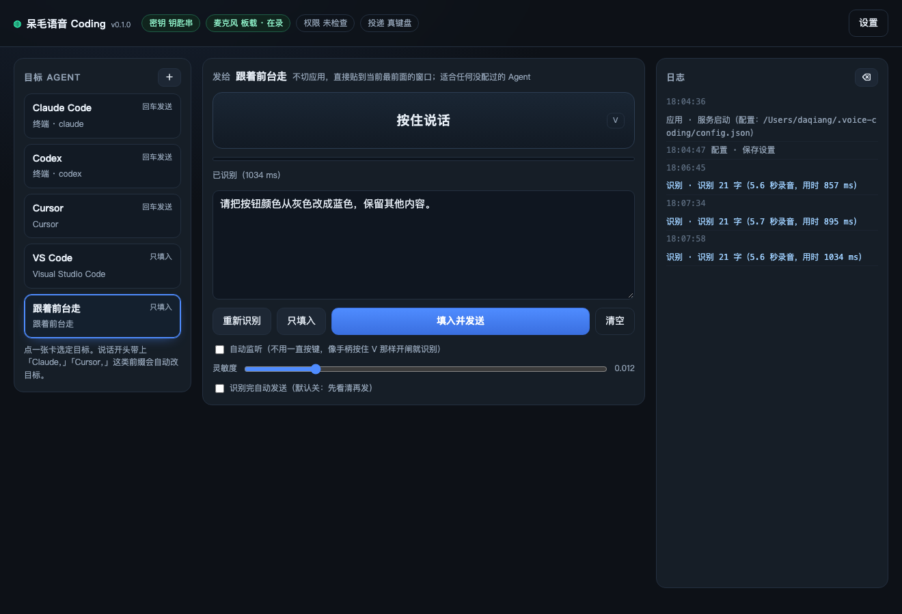

# 呆毛语音 Coding · 电脑端 APP（需求 1）

一句话：**按住说话 → 手柄麦克风的音频在电脑上转成文字 → 自动填进你选定的 Agent（Claude Code / Codex / Cursor / 任意应用）→ 可以回车发送。**

这是需求 1「电脑端 APP 语音 coding」的实现：语音转文字（ASR）、填进对应 Agent、可操作发送。硬件仍是 E24 手柄，音频只从它暴露的 USB 麦克风取（联调档名字是 `Held-key microphone`）——**电脑和手机的麦克风不会被使用**。



> 发给同事时看这份就够了：[START-HERE.md](START-HERE.md)（授权、换自己的密钥、没板子怎么试）。

## 状态

| 项 | 结论 | 依据 |
|---|---|---|
| 语音转文字 | **已实测** | 真调百炼 `qwen3-asr-flash`；5.1 秒音频 → 823–1080 ms，16 秒音频 → 2.1–2.5 s，中文整句正确 |
| 填进 Agent + 回车 | **已实测** | 真往 TextEdit 新文档里粘贴并回车，读回文字与换行都一致（`tools/selftest.mjs` 5/5） |
| 切应用 / 开终端窗口 | **已实测（单应用）** | 用 `open -b` + 前台校验；终端 `do script` 分支只在电脑端验证过，未接真手柄 |
| 手柄实物全链路 | **未验证** | 本机没插 E24（`system_profiler` 里没有 AI KEY，也没有 `Held-key microphone`）。音频通道与网页取流同一套代码，但「按住手柄 V 放行声音」这一步要上板才算数 |
| 手柄四键 | **已接入，待上板确认** | V 按住录音 / L 发送 / R 清空；HID 状态 10 Hz 实物可读，但主机发命令这条只在电脑端验证到「发得出去」，设备回执没等到 |
| 麦克风来源 | **只认板子** | 只接受 `Held-key microphone` / `AI KEY Mic POC`；没插板子就拒绝录音并提示，不会退回电脑或手机麦克风（8 项单测） |
| 浏览器里的完整流程 | **已用 CDP 驱动跑通** | 无头 Chrome 里模拟板载麦克风：点击说话 → 切句 → 识别出「请把按钮颜色从灰色改成蓝色，保留其他内容。」（857–1034 ms）；返回电脑/手机麦克风时当场拒绝录音。人工用真手指点还没走过 |
| 界面渲染 | **已核对** | 1320×900 截图与 DOM 断言：待授权 / 板子未接 / 板载 三种状态都对 |

口径照旧：**电脑端 PASS ≠ 上板 PASS**。

## 快速开始

0. **把 E24 用 USB 插上，烧带音频的联调档**（系统里会出现 `Held-key microphone`）。程序只认这颗麦克风，没插板子就不录音。
1. 双击 `start.command`。它会起本机服务（默认 http://127.0.0.1:8899）并用 Chrome 应用窗口打开界面。
2. 第一次要在页面里允许**麦克风**；系统设置 → 隐私与安全性 → **辅助功能** 里给终端（或 Chrome）打勾，程序才能往别的应用里打字。点设置里的「检查辅助功能权限」可以自查，当前前台应用名能读出来就说明通了。
3. 左边选一个 Agent → 按住 `V`（或按住「按住说话」）→ 说完松开 → 文字出现在中间 → 「只填入」或「填入并发送」。
4. 不想让它自动回车，把「识别完自动发送」关掉（默认就是关的）；想先看会做什么，打开「演练模式」，它只算步骤不动键盘。

键盘：`V` 按住说话，`L` 发送，`R` 清空，`⌘↵` 在输入框里直接发送。

## 为什么这样分

网页控制不了别的应用，也模拟不了系统按键；反过来，纯原生程序做界面又要重写一遍。所以按能力分层：

| 层 | 文件 | 干什么 |
|---|---|---|
| 界面 | `public/index.html`、`app.js`、`style.css` | 选 Agent、按住说话、改文字、看日志 |
| 取音 | `public/recorder.js`、`mic-match.js`、`vad.js` | 只认板载麦克风（名字匹配 + 取到后二次校验），16 kHz 单声道；`VadSegmenter` 管自动切句和电平 |
| 本机服务 | `src/server.mjs` | 只监听 127.0.0.1；静态页 + 全部 API |
| 语音转文字 | `src/asr.mjs` | 调百炼 `qwen3-asr-flash`，错误分门别类，5xx/429 自动重试一次 |
| 投递 | `src/deliver.mjs` | 切前台 → 剪贴板粘贴 → 回车；文本一律走 `osascript` 的 argv，不拼脚本 |
| 配置 | `src/config.mjs` | `~/.voice-coding/config.json`，原子写、权限 600、坏配置不拖垮服务 |
| 密钥 | `src/secrets.mjs` | 只从 macOS 钥匙串或环境变量读，不写进配置和日志 |

## Agent 怎么配

一个 Agent = 一个「去哪说话」的位置。字段：

| 字段 | 说明 |
|---|---|
| 名称 / 别名 | 别名用于语音前缀路由，例如 `claude`、`克劳德`、`cc` |
| Bundle ID / 应用名 | 二选一。都留空 = **跟着前台走**，不切应用 |
| 终端命令 | 填了就先开一个新终端窗口跑它（例如 `claude`、`codex`），再往里贴 |
| 工作目录 | 开终端窗口时先 `cd` 到这里，可空 |
| 发送方式 | `回车发送` / `⌘回车` / `只填入`。VS Code 这类焦点不固定在 AI 输入框的，默认只填入更安全 |

自带的几个：**Claude Code**（终端 + `claude`）、**Codex**（终端 + `codex`）、**Cursor**、**VS Code**（只填入）、**跟着前台走**。

投递顺序是固定的，写死在代码里而不是让模型决定：先开窗口（如果配了命令）→ 切前台并**校验真的到了前台**（`bundle identifier of first application process whose frontmost is true`）→ 粘贴 → 可选回车。目标没到前台就报错退出，**绝不把文字贴到别的窗口**。

## 语音前缀路由

说「**Cursor，**把这段抽成函数」，会自动切到 Cursor 并把前缀去掉；说「**Claude，**跑一下测试」，同理。只有别名后面跟着分隔符（`，` `:` 空格等）才算，所以「Cursor 里那个函数报错了」不会误切。可以在设置里关掉。

## 语音转文字

- 模型：`qwen3-asr-flash`（百炼原生多模态接口），地址默认 `https://dashscope.aliyuncs.com`；用自己 workspace 的专属端点时改 `~/.voice-coding/config.json` 的 `asr.baseUrl` 或设 `VOICE_CODING_ASR_BASE`。
- 走 `POST /api/v1/services/aigc/multimodal-generation/generation`，音频以 `data:audio/wav;base64,` 传；带 `asr_options.language=zh`、`enable_itn=true` 和一份热词表（Claude Code、Codex、Cursor、Git、commit、提交、回滚…），专有名词更稳。
- 实测：5.1 秒「请把按钮颜色从灰色改成蓝色，保留其他内容。」→ 823 ms；16 秒整段 → 2096 ms。
- 密钥：macOS 钥匙串 `voice-coding-bailian` / `DASHSCOPE_API_KEY`，或环境变量 `DASHSCOPE_API_KEY`。设置面板里可以填一次存进钥匙串。**源码、配置、日志里都没有密钥。**

## 手柄按键（四个键里挑一个按住说话）

| 键 | 作用 | 为什么 |
|---|---|---|
| **V** | 按住录音，松开结束 | 固件的隐私闸门 `ak_mic_permitted()` 要求「recording + mic_power + mic_ready + HOST + **V 按住**」同时成立；`AK_RECORD` 在没按住 V 时直接返回 `HELD` |
| L | 填入并发送 | 按键映射在 `public/controller-keys.js`，改起来是一行 |
| R | 清空 | 同上 |
| S | 暂不绑定 | 同上 |

**为什么不能换成别的键录音**：闸门是固件写死的 V。用 L/R/S 录音，麦克风根本不会开（录到全零）。要换键得改固件（`controller.c` 里 `AK_VOICE` 那一处），不在这次范围内。

**默认只听，不抢指针**：设备每 100 ms 发一帧报告 2，里面就带四键状态，打开设备（WebHID）就能读，不需要 HELLO/CLAIM。所以接管按键时**鼠标照常可用**，这是默认模式（`public/controller.js` 的 `ControllerSession`）。

**需要时再接管**：固件的隐私闸门若按「V 按住 + HOST + 已请求录音」生效，只听模式下的麦克风会是全零。这时点「接管出声」：HELLO → CLAIM 拿 HOST → 每 200 ms KEEPALIVE（固件租约 750 ms）→ 录音时发 RECORD(1)。代价是**接管期间手柄不再是鼠标**（`ak_pointer_allowed()` 只认 POINTER），点「交还指针」还回去。网页没法注入系统光标，所以没做「接管时仍当鼠标」。

> 2026-11-16 在这块板上的实测：**不接管也能录到声音**（日志里 19:34 那条 3.1 秒录音确实识别出了文字），说明当前烧的固件并没有把 UAC 麦克风卡在 HOST 上。所以默认只用「只听」模式；「接管出声」留作兜底。

**后台不降频**：启动脚本给 Chrome 加了 `--disable-background-timer-throttling --disable-backgrounding-occluded-windows --disable-renderer-backgrounding`。窗口被别的应用挡住或失焦时，KEEPALIVE 一旦被降频，750 ms 租约就过期，按住 V 也不出声。

### 这条链路的实测边界（2026-11-16，真板 AI KEY E24）

| 环节 | 结论 |
|---|---|
| 设备枚举 | **实物 PASS**：USB HID `AI KEY E24`（VID 0xCAFE / PID 0x4031，报告 1/2/3）+ 音频 `Held-key microphone` 都在系统里 |
| 设备到主机（报告 2） | **实物 PASS**：用 IOKit 读真板，状态帧 10 Hz 到达，session / owner / buttons 都能解出来，CRC 对得上 |
| 按键到界面 | **电脑端 PASS**：边沿识别（按下/松开各一次、双击不重复）、坏帧丢弃、四键位掩码都有单测；真板抓到的整帧能原样解析（见下） |
| 麦克风供电/闸门 | **实物旁证**：19:34 的一次 3.1 秒录音（未接管、未发任何命令）识别出了文字，说明当前固件没有把 UAC 麦克风卡在 HOST 上 |
| 主机到设备（命令） | **未验证**：用 IOKit 直接 `IOHIDDeviceSetReport`（seize、带/不带报告号、32/33 字节都试过）返回成功但设备没有任何回执（状态帧里的 command_sequence 一直是 0）。这也是默认走「只听」的原因——只读不需要发命令。Chrome 的写通道能不能通，点「接管出声」就知道了 |
| V 按住录音 | **未验证**：需要人按板子上的键 |

真板抓到的完整状态帧（2026-11-16，IOKit 直读）：

`01800000cb0c39e21800000010780b000000000500000000000000000000b4ef`

解析结果：`type=STATUS owner=POINTER buttons=0 session=3795389643 sequence=24 faults=5`。`faults=5` 是 `FAULT_IMU(1) | FAULT_HAPTIC(4)`（本档没有触觉，IMU 位是粘着的，没查原因）；**音频故障位（bit1）是 0**，麦克风这一路没报故障。

**怎么确认**：页面里点「连接手柄」→ 选中 AI KEY → 按住 V。

- 徽标「手柄 按键可用」= 设备已打开、按键在收；
- 右侧日志里会出现 `手柄按键 V 按下` / `手柄按键 V 松开`，同时麦克风开始/停止；
- 真录到全零时界面会提示「点『接管出声』」，那时才需要 HELLO/CLAIM；接管成败会在日志里写明（`HELLO 回执 OK`、`CLAIM 回执 HELD` 等）；
- 接管一直失败：到 系统设置 → 隐私与安全性 → 输入监控 给 Chrome 打勾，重连再试。

### 命令通道会「哑掉」（2026-11-16 实测）

接管要靠 HID 写命令（HELLO/CLAIM/KEEPALIVE/RECORD）。实测这套固件有两个脾气：

1. **第一包可能丢**：刚打开设备就发的 HELLO 没回执。现在 `claim()` 先等一帧状态拿到 session，再重试最多 4 次。
2. **通道会卡死**：连续开关页面几次之后，写命令全部超时（状态帧照常 10 Hz 到达，说明只是写方向哑了）。对设备做一次 USB 重枚举（`USBDeviceReEnumerate`，工程里 `usbreset.swift` 就是干这个的）立刻恢复，之后 HELLO/CLAIM/KEEPALIVE 全部回 OK。
   现场处理：**拔插一次板子**，页面会在 10 秒内自动重连并重新接管（`autoConnectController()`）。

这些现象指向固件的 OUT 端点处理（TinyUSB 侧），不是上位机的问题；要根治得动固件。

## 麦克风只认板子

需求是「用板子上的麦克风」，所以取音这一层是**硬约束**，不是默认值：

- 设备匹配只认 `Held-key microphone`（联调档）/ `AI KEY Mic POC`（POC 档）这两个名字，电脑内置麦、iPhone、AirPods、BlackHole、聚合设备一律不认。
- 没授权时设备名是空的，程序**不猜**：状态显示「待授权」，第一次按说话时申请一次权限再重新匹配。
- 取到音频流之后还会再校验一次 track 的真实名字（`public/recorder.js` 里的 `BoardMicError`）。名字对不上就立刻停掉轨道、报错，**不录音**——防止浏览器忽略 deviceId 或系统默认设备被换掉时悄悄录了电脑麦。
- 没有板载麦克风时按说话只弹提示（把板子插上 / 重新读取设备），不会退到内置麦克风。
- 闸门判据：固件在 V 没按住时输出全零。录到全零直接提示「按住手柄 V」并**不送 ASR**，省一次没用的云端请求。
- 名字可以改（设置 → 板载麦克风名称），换固件改了设备名时填新的就行。
- 确实要用电脑麦克风调试时，把「只允许板载麦克风」关掉即可（默认开）。这时候界面会明说「说话内容会送云端识别」。

## 权限

| 权限 | 用来做什么 | 怎么给 |
|---|---|---|
| 麦克风 | 取手柄 / 内置麦克风的音频 | 页面里第一次说话时点允许 |
| 辅助功能 / 自动化 | 让程序替你按键（粘贴、回车）、读前台应用名 | 系统设置 → 隐私与安全性 → 辅助功能，勾上终端或 Chrome |
| 调取应用 | `open -b` 打开并切到目标应用；开终端窗口跑命令 | 系统自带，不需要额外授权 |

## 验证

```
cd 源码与文档/prototype/voice-coding
npm test          # 71 项单元/接口测试，全过（约 3 秒）
npm run selftest  # 真调 ASR + 真往 TextEdit 打字，5/5 全过（不需要麦克风，用的是现成 WAV）
```

`npm test` 覆盖：板载麦克风匹配（认板子、拒电脑/手机/聚合设备、无授权不猜、deviceId 失效回退按名字找）、WAV 封装与解析、配置校验与前缀路由、ASR 请求体/错误分类/重试/超时、投递步骤（前台校验、argv 传文本、剪贴板还原、dryRun、只填入）、VAD 切句与电平、HTTP 接口（ASR/投递/Agent 存读/设置合并/路由/权限/静态页/越权路径）。

另外做过一次**接口级端到端**：把 `voice-change-color.wav` 的 PCM 从 HTTP 送进 `/api/asr`，再到 `/api/deliver` 打进 TextEdit，读回一致；`/api/route` 对「Cursor，把按钮改成蓝色」返回 `cursor` + 去掉前缀的文字；演练模式下投递只返回步骤、不动键盘。

`npm run selftest` 的实测输出：

```
✔ ASR 密钥可用 · keychain · sk-ws-…Xdag
✔ ASR 识别 · 你好，这是智慧呆毛的麦克风闭环测试。……（16.0 秒录音 → 2083 ms）
✔ 辅助功能 / 自动化 · 当前前台：TextEdit
✔ 投递到 TextEdit · 切到 文本编辑 → 粘贴 19 个字 → 回车发送 · 读回一致
✔ 回车已发送 · 正文后面多了一个换行
```

### 浏览器里跑过的完整流程（无头 Chrome + CDP）

用 AudioBufferSource → MediaStream 假装一颗名叫 `Held-key microphone` 的设备，把 5 秒真人语音喂进页面，真点界面上的「按住说话」：

| 场景 | 结果 |
|---|---|
| 设备列表里有板载麦克风 | 徽标「麦克风 板载」、下拉只有「★ Held-key microphone」，电脑麦克风不出现 |
| 按住说话 → 松开 | 切句 → 送 ASR → 输入框出现「请把按钮颜色改成蓝色，保留其他内容。」，耗时 857–1034 ms，日志记「识别 21 字（5.6 秒录音）」 |
| 浏览器返回的是 `MacBook Pro麦克风` | 立刻停掉，提示「取到的不是板载麦克风（拿到的是「MacBook Pro麦克风」），已放弃这次录音」，状态没有进入录音 |
| 浏览器返回的是 `iPhone 麦克风` | 同上，提示里点名的是 iPhone 麦 |
| 只有电脑和手机麦克风 | 徽标「麦克风 板子未接」，按说话直接提示插板子，不弹权限框也不录音 |

截图就是上面那张：徽标「麦克风 板载 · 在录」，输入框里是识别结果，右边日志是三次真实识别的耗时。

## 已知限制

1. **没接真手柄**：`Held-key microphone` 不在系统设备列表里，所以这台机器上按「按住说话」会直接提示「板子未接」，这是设计如此。浏览器流程用「假设备 + 真语音」跑通了，但走的是 `getUserMedia` 的替身；**真板的 USB 音频枚举、按住 V 开闸出声、闸门关闭时全零**这三件事要上板才算。
2. **没接管手柄按键**：现在靠键盘 V 或自动监听切句，没有通过 WebHID 读手柄的 V/L/R。灵动岛 POC 里的 `HidLink` 已有协议实现，接上是下一步。
3. **剪贴板还原只支持文字**：原来剪贴板是图片/文件时，粘贴完会被清掉。要用原生 NSPasteboard 才能完整还原。
4. **应用焦点靠前台校验**，不做窗口级定位：同一个应用有多个窗口时，进的是它当前最前面的那个。
5. **Cursor / VS Code 的 AI 输入框焦点**要你手动点进去；默认给 VS Code 配的是「只填入」。
6. **日志**写在 `~/.voice-coding/logs/日期.log`，含识别文字；音频不落盘。

## 为什么没有用 Docker

这是 macOS 本机应用：要用系统麦克风、辅助功能和 `osascript` 去驱动其它 GUI 应用，容器里既没有麦克风也没有 GUI 会话，Docker 化没有意义。换成「服务端转发 ASR、客户端只做本地投递」才适合容器化，那是另一个形态。

## 目录

```
voice-coding/
├── start.command              双击启动（起服务 + Chrome 应用窗口）
├── package.json               零依赖；npm start / npm test / npm run selftest
├── src/
│   ├── server.mjs             本机服务与全部 API
│   ├── asr.mjs                qwen3-asr-flash 客户端
│   ├── deliver.mjs            切前台、粘贴、回车（AppleScript via argv）
│   ├── osascript.mjs          osascript 调用与超时
│   └── config.mjs / secrets.mjs / wav.mjs
├── public/                    界面（原生 ES 模块，无需构建）
│   ├── mic-match.js           板载麦克风识别规则（纯函数，可单测）
│   ├── controller-keys.js     四键 → 动作（纯函数，可单测）
│   ├── aikey-frames.js        AI KEY v1 帧编解码（与工程参考实现交叉核对）
│   ├── controller.js          WebHID 会话：只听按键，可选接管出声
│   ├── recorder.js / vad.js   取流与切句
├── tests/                     71 项测试
├── tools/selftest.mjs         真 ASR + 真投递自检
└── docs/screenshot.png
```

配置在 `~/.voice-coding/config.json`（首次运行自动生成），日志在 `~/.voice-coding/logs/`。环境变量：`PORT`（默认 8899）、`VOICE_CODING_HOME`、`DASHSCOPE_API_KEY`。
